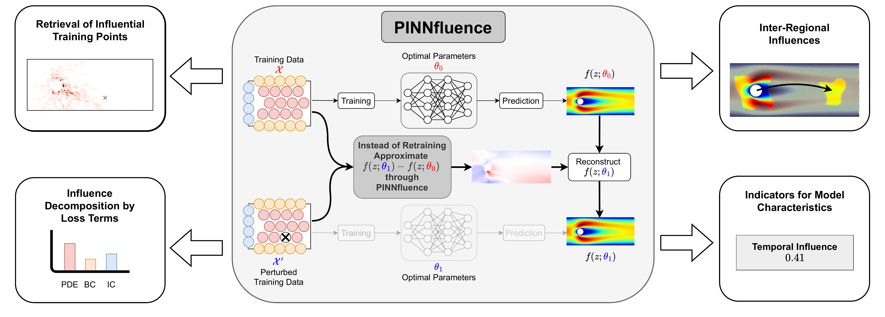
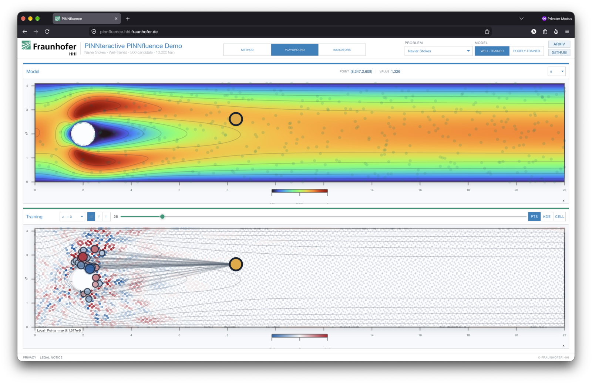

# PINNfluence: Interpreting PINNs through Influence Functions

_Aleksander Krasowski\*, Jonas R. Naujoks\*, Moritz Weckbecker, Galip Ü. Yolcu, Thomas Wiegand, Sebastian Lapuschkin, Wojciech Samek, René P. Klausen_ — **ICML 2026**

[](https://arxiv.org/abs/2409.08958) [](https://pinnfluence.hhi.fraunhofer.de) [](https://icml.cc/virtual/2026/poster/61837)



This repository contains two things:

- [pinnfluence_torch/](pinnfluence_torch/): a small, PyTorch implementation of
  PINNfluence that you can apply to your own PINN. **Start here if you want to use the method.**
- [pinnfluence/](pinnfluence/): the DeepXDE-based CLI and library behind the experiments,
  figures, and influence-based diagnostics in the paper. Start here if you want to reproduce
  or extend the paper's results.

### Interactive web demo

Try PINNfluence in your browser: **[pinnfluence.hhi.fraunhofer.de](https://pinnfluence.hhi.fraunhofer.de)**

> Credit and a big thank you go to my colleague and friend Gerrit Dolderer, who implemented the demo!

[](https://pinnfluence.hhi.fraunhofer.de)

### PyTorch demo: PINNfluence on your own PINN

You can find a demo notebook under [pinnfluence_torch/demo.ipynb](pinnfluence_torch/demo.ipynb), which trains a PINN on the drift-diffusion equation and walks through the analysis with PINNfluence.
It also shows how one could build a wrapper around their own PINN to analyse it using the proposed method using the code implemented in [pinnfluence_torch/pinnfluence_torch.py](pinnfluence_torch/pinnfluence_torch.py).

### Paper demo notebook (DeepXDE)

[notebooks/demo.ipynb](notebooks/demo.ipynb) recreates the drift-diffusion experiment from
the paper with an implementation based on [DeepXDE](https://github.com/lululxvi/deepxde) (a library for training PINNs) which was used in the manuscript.
It is the right place to poke at what the paper covers and the starting point for running the
analysis on the remaining problems (see [Reproducing the experiments](#reproducing-the-experiments)
for the full pipeline).

> Since this notebook carries the full experiment machinery, it is a little more elaborate
> than a demo strictly needs. To apply PINNfluence to your own model, use the PyTorch
> demo above.

### Abstract

> Physics-informed neural networks (PINNs) have emerged as a powerful deep learning approach for solving partial differential equations (PDEs) in the physical sciences, yet their behavior remains largely opaque and is typically understood through failure mode analyses rather than explicit interpretability. To address this issue, we introduce PINNfluence, a training data attribution framework for interpreting PINNs based on influence functions. By extending influence functions to composite physics-informed training objectives, we enable fine-grained attribution between predictions, loss components, and training data points. Through benchmark experiments across various PDEs, we demonstrate that influence patterns provide granular diagnostics that distinguish structural characteristics across well-trained and poorly-trained PINNs. PINNfluence thus opens a new avenue for understanding and improving the reliability of PINNs through the lens of their data.

## Requirements

We heavily recommend using [uv](https://docs.astral.sh/uv/getting-started/) to create a
virtual environment and for quick dependency resolution.

If you're not familiar with it we recommend checking it out — although a plain `pip install .`
from the project root also works.

Create and activate a virtual environment, then install the package with its dependencies:

```bash
uv venv --python 3.13
source .venv/bin/activate
uv pip install .      # from inside the project root
```

### Alternative: installation using `pip`

```bash
pip install .         # from inside the project root
```

> Note: the code should work with other Python versions (requires `>=3.11`), but we only
> tested it on 3.13.

> Code was tested and should work on both Linux (`amd64`) and macOS (`arm64`).

## Reproducing the experiments

The package exposes three command-line entry points (run each with `--help` for the full
option list):

```bash
# 1. Pretrain a PINN (Adam + L-BFGS) for a given problem
python -m pinnfluence.pretrain --problem drift_diffusion --float64 --save_path ./model_zoo

# 2. Precompute influence scores for a trained checkpoint
#    --right / --left select the training- and test-side loss terms
python -m pinnfluence.precalculate_influences \
    --problem drift_diffusion --float64 \
    --load_path ./model_zoo --save_path ./model_zoo \
    --right total_loss --left total_loss

# 3. (Appendix C.4) Train with the SOAP or NNCG optimizer
python -m pinnfluence.pretrain_w_NNCG_SOAP --problem drift_diffusion --optimizer SOAP --float64
```

The seven problems in the paper are registered in
[`pinnfluence/utils/defaults.py`](pinnfluence/utils/defaults.py) (`PROBLEMS` for
well-trained, `BAD_PROBLEMS` for poorly-trained): `allen_cahn`, `burgers`, `diffusion`
(= Heat), `drift_diffusion`, `wave`, `navier_stokes_nd`, and `poisson_disk`.

## Citation

If you use PINNfluence in your work, please cite:

```bibtex
@InProceedings{krasowskinaujoks2026pinnfluence,
  title =   {{PINN}fluence: Interpreting {PINN}s through Influence Functions},
  author =       {Krasowski, Aleksander and Naujoks, Jonas and Weckbecker, Moritz and Yolcu, Galip \"{U}mit and Wiegand, Thomas and Lapuschkin, Sebastian and Samek, Wojciech and Klausen, Ren\'{e} Pascal},
  booktitle =   {Proceedings of the 43rd International Conference on Machine Learning},
  pages =   {61025--61064},
  year =   {2026},
  volume =   {306},
  series =   {Proceedings of Machine Learning Research},
  month =   {06--11 Jul},
  publisher =    {PMLR},
}
```

## AI usage disclosure

Parts of this repository were developed with the assistance of AI-based coding tools.
We have reviewed, tested, and curated the generated code to the best of our ability to
ensure it meets our quality standards and faithfully reproduces the results reported in
the paper. Nevertheless, as with any software, bugs or rough edges may remain. If you run
into a problem, please open an issue or a pull request — we are happy to take a look and
will do our best to address it.
