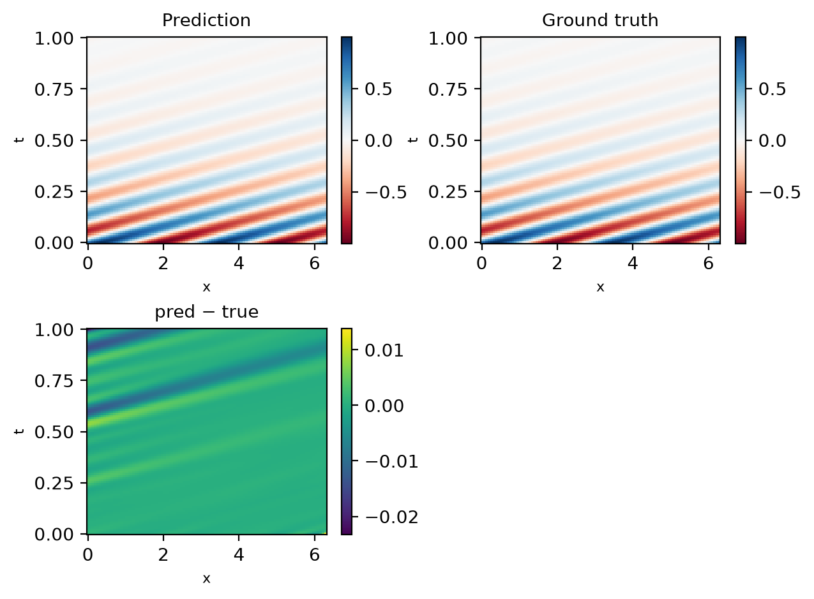
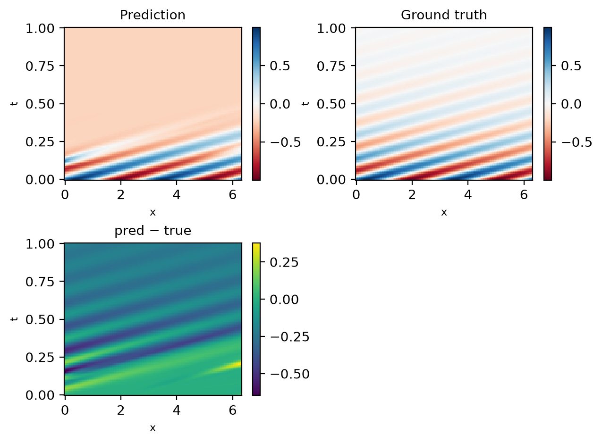

# PINNfluence in plain PyTorch

PINNfluence answers one question about a trained PINN: **which training points shaped
this prediction, and through which loss term** (PDE residual, initial condition,
boundary condition)? It does so with influence functions and gives you a score for
every (test point, training point, loss term) triple.

This folder is a minimal example of that in PyTorch, without DeepXDE (which the main package uses):

```
pinnfluence_torch.py   influence related functionalities: loss and the influence-function wrappers
utils.py               demo-only helpers: the MLP and plots of the influence results
demo.ipynb             the example, start to finish: PINN, training, influence analysis
results/<config>/      pretrained checkpoints so the notebook runs without training
```

## Run the demo

1. Install the main package from the repository root. This brings PyTorch and my
   [captum fork](https://github.com/aleks-krasowski/captum) that implements the
   influence functions:

   ```bash
   uv pip install .   # or: pip install .
   ```

2. Open [`demo.ipynb`](demo.ipynb) from inside this folder and run it top to bottom.
   You can choose a model configuration at the top:

   - `CONFIG`: `"good"` is a well-trained PINN (1000 domain, 100 boundary, 100 initial
     points), `"bad"` a poorly-trained one (200 / 20 / 20).
   - `TRAIN`: `False` loads the shipped checkpoint, `True` retrains it (Adam, then
     L-BFGS, about 5-10 min on a CPU).

The PINN solves the 1D drift-diffusion equation `u_t = u_xx - 20 u_x` on `[0, 2*pi] x [0, 1]`
with `u(x, 0) = sin(2x + pi/4)` and periodic boundaries. It is strongly
advection-dominated, where the poorly-trained model exhibits _information propagation failure_:

| `good` | `bad` |
| --- | --- |
|  |  |

The loss has four terms: PDE residual, initial condition (`t = 0`), and one term per side of the
periodic boundary (`x = 0` and `x = 2*pi`), so influence can be attributed to each side.
The notebook then shows, for both models, which training points matter overall, which
ones matter for a single prediction, and how much of that influence flows through each
loss term.

## Use it on your own PINN

PINNfluence only needs three things.
1. The trained PINN
2. A wrapper around the residuals
3. Training points and test points to evaluate on

```python
import torch
from torch import nn
from pinnfluence_torch import PINNLossWrapper, instantiate_precomputed_influence, compute_influence_matrix

# 1. Your trained network, any nn.Module mapping [B, d_in] -> [B, d_out].
net = ...

# 2. Your residuals: one row per training point, one column per loss term.
class MyResiduals(nn.Module):
    def __init__(self, net):
        super().__init__()
        self.net = net                       # the library reads .net to attribute for 
                                             # individual outputs -- "output_N"

    def forward(self, x):                    # x: [B, d_in] 
                                             # here d_in = 2, with columns (x, t)
        u = self.net(x)
        du = torch.func.grad(lambda z: self.net(z).sum())(x)   # [B, 2]: du/dx, du/dt
                                                               # you can also use torch.autograd.grad
                                                               # but then influence calculation will be slower
        pde = du[:, 1:2] + du[:, 0:1]                           # PDE residual
        ic = (u - u0(x)) * (x[:, 1:2] == 0).to(u.dtype)         # only where t == 0
        bc = (u - u_bc(x)) * (x[:, 0:1] == 0).to(u.dtype)       # only where x == 0
        zero = u.sum() * 0                   # keeps every parameter in every column's graph
        return torch.cat([pde + zero, ic + zero, bc + zero], dim=1)   # [B, 3] (or any other number of loss terms)

# 3. Your training points, stacked into one array [N, d_in]: domain + initial + boundary.
x_train = ...

# Build the influence object once. This approximates the inverse Hessian of the
# total training loss (the mean of the squared residual columns) and takes seconds for small problems.
residual_fn = MyResiduals(net)
IF = instantiate_precomputed_influence(residual_fn, x_train, PINNLossWrapper())

# Ask: how does each training point, acting through the initial condition (column 1),
# change the prediction at each test point?
scores = compute_influence_matrix(IF, residual_fn,
                                  test_term="output_0",   # what is explained
                                  train_term=1,           # through which loss term
                                  candidate_points=x_test)
# scores[i, j] > 0: upweighting training point j pushes the prediction at test point i up.
```

